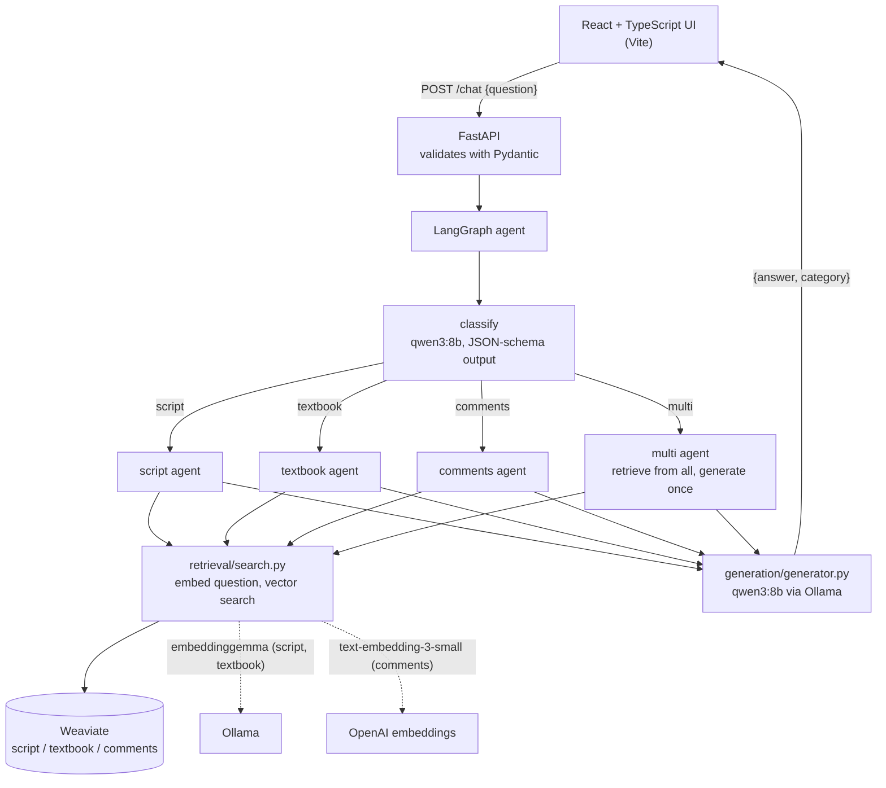

# Tesseract v2

A multi-agent RAG chatbot that answers questions about the film *Interstellar*. A question is routed to the right knowledge source (screenplay, science textbook, viewer comments, or several at once), relevant passages are retrieved from a vector database, and a local LLM writes an answer grounded in those passages.

v2 is a rewrite of [youtube-intelligence-engine](https://github.com/sjv24/youtube-intelligence-engine) (Streamlit, single-folder scripts) as a typed full-stack application: React + TypeScript frontend, FastAPI backend, and a LangGraph agent with a structured-output router.

## Architecture



**Request flow:** the question is validated, classified into one of four categories, the matching agent embeds it with the same model that embedded that collection, Weaviate returns the 5 nearest chunks per source, and one generation call writes the answer from those chunks.

## Design decisions

- **Structured-output routing.** The classifier is constrained to a JSON schema (`Literal["script", "textbook", "comments", "multi"]`) and validated with Pydantic, instead of parsing free text.
- **Embed with the model that built the index.** Script and textbook chunks use Ollama `embeddinggemma` (768 dims); comments use OpenAI `text-embedding-3-small` (1536 dims). Mixing them gives meaningless similarity scores.
- **Retrieve from all sources, generate once (multi).** An earlier design ran a full agent per source and then a synthesis call, so a multi-source question needed four LLM calls. Retrieval is cheap and generation is slow, so multi retrieves from every source and generates a single answer from tagged excerpts.
- **Grounded answers.** The system prompt restricts the model to the retrieved excerpts and tells it to say it doesn't know otherwise.
- **Layered backend.** `api/` (HTTP) calls `agent/` (routing) which calls `retrieval/` and `generation/`. Request and response shapes live in `schemas/` and are mirrored in `frontend/src/types.ts`.
- **Config in `.env`.** Secrets are read through `pydantic-settings`; `.env` is git-ignored and `.env.example` documents the variables.

## Project structure

```
backend/
  app/
    main.py          FastAPI app, CORS, routers
    api/chat.py      POST /chat
    schemas/chat.py  ChatRequest / ChatResponse (Pydantic)
    agent/           router.py (classifier), graph.py (LangGraph)
    retrieval/       search.py (embedding + Weaviate query)
    generation/      generator.py (prompt + Ollama call)
    core/config.py   settings from .env
frontend/
  src/               App.tsx, api.ts, types.ts
```

## Running it locally

**Prerequisites:** Python 3.11+, Node 22+, Docker, [Ollama](https://ollama.com), and an OpenAI API key (only needed for the `comments` and `multi` routes).

```bash
ollama pull qwen3:8b
ollama pull embeddinggemma
```

**Data:** the backend reads three existing Weaviate collections (`Interstellar_Script`, `Interstellar_Textbook`, `Interstellar_Comments`) built by the ingestion pipeline of v1. Weaviate must be running on `localhost:8080` with those collections populated. The ingestion scripts are not part of this repository yet.

**Backend**

```bash
cd backend
python -m venv .venv
.venv\Scripts\activate            # macOS/Linux: source .venv/bin/activate
pip install -r requirements.txt
cp ../.env.example ../.env        # then set OPENAI_API_KEY
uvicorn app.main:app --reload
```

API docs are served at <http://127.0.0.1:8000/docs>.

**Frontend**

```bash
cd frontend
npm install
npm run dev
```

Open <http://localhost:5173>.

## API

`POST /chat`

```json
{ "question": "Is the tesseract scene scientifically accurate?" }
```

```json
{ "answer": "...", "category": "multi" }
```

Invalid input (empty or over 1000 characters) returns `422` before any model is called.

## Known limitations

- A request takes roughly 15 to 60 seconds on a laptop GPU, depending on the route; responses are not streamed yet.
- Retrieval is plain vector search over small, fixed-size chunks; some chunks start or end mid-sentence and some source text has encoding damage, which can make answers slightly inaccurate.
- The API URL and CORS origin are hardcoded for local development.
- No automated tests or evaluation set yet.

## Roadmap

- Evaluation set with retrieval hit rate, recall@k, answer accuracy and p50/p95 latency
- Tests (pytest for the backend, Vitest for the UI)
- Hybrid search and better chunking, measured against the eval set
- Streaming responses and embedding caching, with before/after latency numbers
- Docker Compose, linting and formatting, CI
