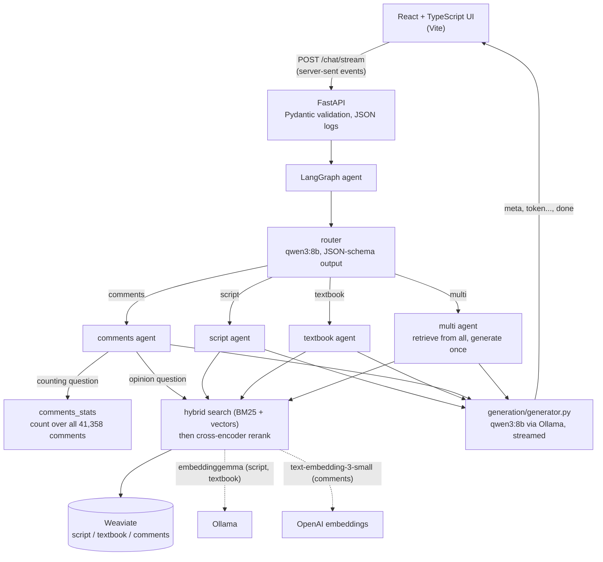

# Tesseract v2

A multi-source RAG chatbot about the film *Interstellar*. A question is routed to the right knowledge source (screenplay, science textbook, viewer comments, or several at once), the best passages are retrieved with hybrid search and a reranker, and a local LLM writes an answer grounded in those passages, with citations. Counting questions about the 41,358 viewer comments ("how many comments mention Tom?") are answered by code that counts them, not by a model that guesses.

Every change was measured on a 106-question golden set and logged in [EVALS.md](EVALS.md), including the changes that did not help and were reverted.

v2 is a rewrite of [youtube-intelligence-engine](https://github.com/sjv24/youtube-intelligence-engine) (a Streamlit app built from notebooks) as a typed full-stack application: React + TypeScript frontend, FastAPI backend, LangGraph agent, Weaviate, and Ollama for local models.

## Results

Measured on a laptop CPU (no GPU), with `qwen3:8b`. Full method, per-change tables and caveats are in [EVALS.md](EVALS.md).

| What | Original (v1) | Now | Notes |
|---|---|---|---|
| Right passage in the top 5 (hit@5), 46 questions with evidence | 57% | **83%** | structure-aware chunks, hybrid search, reranking. Equal-text check: about half of the early gain was only bigger chunks, so it was measured and reported |
| Router picks the right source | 87% | **92%** (100% on a separate hold-out set) | better prompt; hold-out questions were written after tuning |
| Counting questions about comments turned into the right query | not possible | **100%** golden set (tuned on), **90%** hold-out | the answer is computed over all 41,358 comments |
| Top-5 comments carrying the requested tone | about 60% | **100%** | tone filter on the search |
| Answers faithful to the retrieved excerpts (LLM judge) | 95% | **100%** | judge is the same model that writes answers, so it may favour its own style |
| Correct refusals on unanswerable questions | 62% | see [EVALS.md](EVALS.md) | a bug that answered off-topic questions with a comment count was found and fixed |
| Answer time, median | 14 s | 39 s | the cost of reading bigger chunks on a CPU. The 3-chunk and 4B-model options are in [EVALS.md](EVALS.md) |

Honest weak spots: the judged correctness is in the low 60s, the answer time is far from interactive on a CPU, and with 49 labelled questions one question is about 2 percentage points.

## Architecture



**Request flow:** the question is validated and routed. The matching agent retrieves passages (for the screenplay and textbook: 30 candidates by hybrid search, re-scored by a cross-encoder, best 5 kept), the citations are sent to the browser first, and then the answer streams in as the model writes it.

## Design decisions

- **Evaluation first.** Each change has a row in [EVALS.md](EVALS.md): what changed, the numbers before and after, and what the numbers do not show. Negative results stay in the log (searching both books at once was worse; an "out of scope" router category stole real science questions; a score-based refusal gate had nothing to fix).
- **Structured-output routing.** The router is constrained to a JSON schema and validated with Pydantic instead of parsing free text.
- **Counting by code, not by a model.** "How many..." and "what share..." over the comments are turned into a structured query by a small model call and run by ordinary code, which states what it counted and out of how many.
- **Chunks that follow the document.** Screenplay split by scene, textbook by chapter and section, about 400 tokens with overlap, every chunk carrying section and page for citations. The ingestion code is in `backend/ingestion` and rebuilds the index with one command.
- **Embed with the model that built the index.** Script and textbook use Ollama `embeddinggemma` (768 dims); comments use OpenAI `text-embedding-3-small` (1536 dims).
- **Retrieve from all sources, generate once (multi).** Retrieval is cheap and generation is slow, so a multi-source question retrieves from every source and writes one answer from tagged excerpts.
- **Grounded answers with citations.** The prompt restricts the model to the excerpts; every answer returns the chunk IDs, sections, pages and scores it used.
- **Settings in `.env`.** Index version, search mode, reranking, top-k and model names are settings, so each experiment is a config change that can be measured and reverted.
- **Honest failure modes.** If Ollama or Weaviate is down the API returns a clear 503 instead of a crash.

## Project structure

```
backend/
  app/
    main.py            FastAPI app, CORS, logging
    api/chat.py        POST /chat and POST /chat/stream
    schemas/chat.py    request / response models (Pydantic)
    agent/             router.py, comments_query.py, graph.py (LangGraph)
    retrieval/         search.py (vector + hybrid), rerank.py, comments_stats.py, store.py
    generation/        generator.py (prompt + Ollama call, streaming)
    core/config.py     settings from .env
  ingestion/           chunk.py, embed.py, index.py, run_ingest.py (rebuild the index)
  evals/               golden set, hold-out sets, runner, judge, metrics, robustness set
  tests/               pytest suite (no Ollama or Weaviate needed)
frontend/src/          App.tsx, api.ts (streaming client), types.ts
docker-compose.yml     weaviate + backend + frontend
.github/workflows/     CI: ruff, pytest, frontend lint and build
EVALS.md               the evaluation log
```

## The index (what is in Weaviate)

| Collection | Objects | Embedding | Content |
| --- | --- | --- | --- |
| `Interstellar_Script_v2` | 117 | Ollama `embeddinggemma` | screenplay chunks of about 1,600 characters, with scene, page and chunk ID |
| `Interstellar_Textbook_v2` | 420 | Ollama `embeddinggemma` | textbook chunks of about 1,600 characters, with chapter, section, page and chunk ID |
| `Interstellar_Comments` | 41,358 | OpenAI `text-embedding-3-small` | one YouTube comment per object, with `sentiment` and `aspects` labels |
| `Interstellar_Script`, `Interstellar_Textbook` | 655 / 2,275 | Ollama `embeddinggemma` | the original 245-character chunks (v1), kept for comparison |

The source PDFs are not in the repository because of copyright, so a fresh clone has no index until you supply them. `INDEX_VERSION=v2` selects the structure-aware collections.

## Running it locally

**Prerequisites:** Python 3.11+, Node 22+, Docker, [Ollama](https://ollama.com), and an OpenAI API key (only for the `comments` and `multi` routes).

```bash
ollama pull qwen3:8b
ollama pull embeddinggemma
```

**Option 1: Docker Compose** (Ollama keeps running on your computer, because the containers cannot use the integrated graphics)

```bash
cp .env.example .env     # then set OPENAI_API_KEY and, for the best setup, INDEX_VERSION=v2 RETRIEVAL_MODE=hybrid RERANK_ENABLED=true
docker compose up --build
```

Frontend: <http://localhost:3000>. API docs: <http://localhost:8000/docs>. The compose file reuses the `weaviate_data` volume, so an existing index is picked up.

**Option 2: run the pieces yourself**

```bash
docker run -d --name weaviate -p 8080:8080 -p 50051:50051 -v weaviate_data:/var/lib/weaviate -e PERSISTENCE_DATA_PATH=/var/lib/weaviate semitechnologies/weaviate:1.37.8
```

```bash
cd backend
python -m venv .venv
.venv\Scripts\activate            # macOS/Linux: source .venv/bin/activate
pip install -r requirements.txt
cp ../.env.example ../.env        # then set OPENAI_API_KEY
uvicorn app.main:app --reload
```

```bash
cd frontend
npm install
npm run dev                       # http://localhost:5173
```

**Tests and evaluation**

```bash
cd backend
python -m pytest -q                              # about 30 seconds, no models needed
ruff check .
python -m evals.run_evals --mode retrieval       # minutes: is the evidence in the top 5?
python -m evals.run_evals --mode routing         # minutes: does the router pick the right source?
python -m evals.run_evals --mode full            # about an hour or more on a CPU: whole chatbot
python -m evals.run_evals --mode judge --input evals/results/<run>.jsonl
```

## API

`POST /chat` returns the whole answer:

```json
{ "answer": "...", "category": "multi", "citations": [ { "source": "textbook", "chunk_id": "...", "section": "...", "page": 112, "score": 3.8, "snippet": "..." } ] }
```

`POST /chat/stream` sends server-sent events: `meta` (category and citations), many `token` events with pieces of the answer, then `done` (or `error`). Invalid input (empty or over 1,000 characters) returns `422` before any model is called. If Ollama or Weaviate is unreachable the API returns `503` with a plain message. Every request writes one JSON log line (question, route, chunk IDs, seconds). `GET /health` returns `{"status": "ok"}`.

## Known limitations

- **Speed.** On a CPU-only laptop a typical answer takes about 40 seconds (median) and up to two minutes. A GPU would change this most; smaller models and fewer chunks are measured in [EVALS.md](EVALS.md).
- **Answer quality.** The judged correctness is in the low 60s. Remaining failures are model misreads of the right passage, routing slips between screenplay and textbook, and a few debatable labels.
- **Evaluation size.** 49 questions have evidence labels, so one question moves a score by about 2 points. Several settings were tuned while looking at the same set.
- **Judge.** The LLM judge is the same model that writes the answers; it is a screening tool, not ground truth.
- **Comments labels.** Sentiment and topic labels were generated by a model in v1 and have not been checked by hand.
- **Prompt injection.** The 8B model on its own obeyed injected instructions and leaked its prompt (4 of 8 robustness cases passed; adding prompt rules gave 5 of 8). A code-level deny-list (`app/core/guard.py`) now blocks the obvious phrasings (8 of 8), but it was written after seeing those cases and a differently worded attack will get through.
- **No authentication or rate limiting.** It is built to run on one computer.

## Roadmap

- [x] Typed FastAPI backend, structured-output router, React chat UI
- [x] Ingestion code in this repository (chunk, embed, index), rebuilding the index with one command
- [x] Citations from `/chat`
- [x] Golden dataset with hit@5, MRR, routing, refusal, latency and LLM-judged correctness and faithfulness
- [x] Hybrid search and reranking, each measured
- [x] Structure-aware chunking, compared side by side with the original index
- [x] Computed counting answers and a tone filter for the comments
- [x] Streaming responses, structured logs, Docker Compose, tests and CI
- [ ] Run on a GPU and re-measure latency
- [ ] Larger golden set with human-checked labels, and a second judge model
- [ ] Authentication, rate limiting and tracing for a hosted deployment
