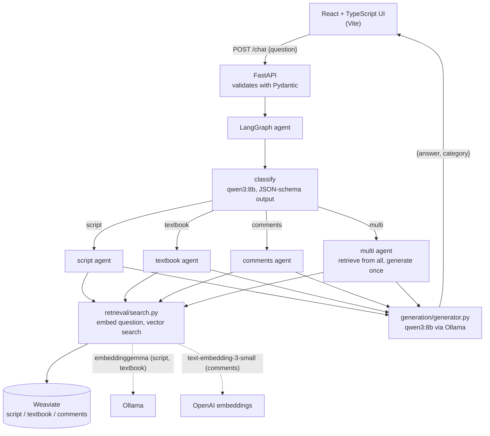

# Tesseract v2

A multi-agent RAG chatbot that answers questions about the film *Interstellar*. A question is routed to the right knowledge source (screenplay, science textbook, viewer comments, or several at once), relevant passages are retrieved from a vector database, and a local LLM writes an answer grounded in those passages.

v2 is a rewrite of [youtube-intelligence-engine](https://github.com/sjv24/youtube-intelligence-engine) (a Streamlit app built from notebooks and scripts) as a typed full-stack application: React + TypeScript frontend, FastAPI backend, and a LangGraph agent with a structured-output router.

## Architecture



**Request flow:** the question is validated, classified into one of four categories, the matching agent embeds it with the same model that embedded that collection, Weaviate returns the 5 nearest chunks per source, and one generation call writes the answer from those chunks.

## Design decisions

- **Structured-output routing.** The classifier is constrained to a JSON schema (`Literal["script", "textbook", "comments", "multi"]`) and validated with Pydantic, instead of parsing free text.
- **Embed with the model that built the index.** Script and textbook chunks use Ollama `embeddinggemma` (768 dims); comments use OpenAI `text-embedding-3-small` (1536 dims). Mixing them gives meaningless similarity scores.
- **Retrieve from all sources, generate once (multi).** An earlier design ran a full agent per source and then a synthesis call, so a multi-source question needed four LLM calls. Retrieval is cheap and generation is slow, so multi retrieves from every source and generates a single answer from tagged excerpts.
- **Grounded answers.** The system prompt restricts the model to the retrieved excerpts and tells it to say it doesn't know otherwise.
- **Layered backend.** `api/` (HTTP) calls `agent/` (routing) which calls `retrieval/` and `generation/`. Request and response shapes live in `schemas/` and are mirrored in `frontend/src/types.ts`.
- **Config in `.env`.** The OpenAI key is read through `pydantic-settings`; `.env` is git-ignored and `.env.example` documents the variable. Model names, the API URL and the CORS origin are still constants in the code.

## Project structure

```
backend/
  app/
    main.py          FastAPI app, CORS, routers
    api/chat.py      POST /chat
    schemas/chat.py  ChatRequest / ChatResponse (Pydantic)
    agent/           router.py (classifier), graph.py (LangGraph)
    retrieval/       search.py (embedding + Weaviate query)
    generation/      generator.py (prompt + Ollama call)
    core/config.py   settings from .env
  evals/
    dataset.jsonl    golden questions for evaluating retrieval and answers (in progress)
frontend/
  src/               App.tsx, api.ts, types.ts
```

## The index (what is in Weaviate)

| Collection | Objects | Embedding model | Content |
| --- | --- | --- | --- |
| `Interstellar_Script` | 655 | Ollama `embeddinggemma`, 768 dims | chunks of about 245 characters from the screenplay |
| `Interstellar_Textbook` | 2,275 | Ollama `embeddinggemma`, 768 dims | chunks of about 245 characters from *The Science of Interstellar* |
| `Interstellar_Comments` | 41,358 | OpenAI `text-embedding-3-small`, 1536 dims | one YouTube comment per object, with `sentiment` and `aspects` from v1's aspect-based sentiment analysis |

All three collections use cosine HNSW vector search and have BM25 keyword indexing enabled (not used by `/chat` yet). Script and textbook chunks carry a `par_ID` (1 to N) in reading order; every object also has a Weaviate UUID.

## Running it locally

**Prerequisites:** Python 3.11+, Node 22+, Docker, [Ollama](https://ollama.com), and an OpenAI API key (only needed for the `comments` and `multi` routes).

```bash
ollama pull qwen3:8b
ollama pull embeddinggemma
```

**Data:** the backend reads the three Weaviate collections described above, which were built outside this repository by the ingestion pipeline of v1. The source PDFs are not included because of copyright, and the ingestion code is not part of this repository yet, so a fresh clone has no index until that is added.

Start Weaviate with a **named volume**. Without one, Weaviate keeps its data inside the container and loses it when the container is removed:

```bash
docker run -d --name weaviate -p 8080:8080 -p 50051:50051 -v weaviate_data:/var/lib/weaviate -e PERSISTENCE_DATA_PATH=/var/lib/weaviate semitechnologies/weaviate:1.37.8
```

It must be reachable on `localhost:8080` with the collections populated.

**Backend**

```bash
cd backend
python -m venv .venv
.venv\Scripts\activate            # macOS/Linux: source .venv/bin/activate
pip install -r requirements.txt
cp ../.env.example ../.env        # then set OPENAI_API_KEY
uvicorn app.main:app --reload
```

API docs are served at <http://127.0.0.1:8000/docs>.

**Frontend**

```bash
cd frontend
npm install
npm run dev
```

Open <http://localhost:5173>.

## API

`POST /chat`

```json
{ "question": "Is the tesseract scene scientifically accurate?" }
```

```json
{ "answer": "...", "category": "multi" }
```

Invalid input (empty or over 1000 characters) returns `422` before any model is called.

`GET /health` returns `{"status": "ok"}` and does not check Weaviate or Ollama.

## Known limitations

- A request takes roughly 15 to 60 seconds on a laptop GPU, depending on the route; responses are not streamed yet.
- Retrieval is plain vector search over small, fixed-size chunks (about 245 characters); most script and textbook chunks start or end mid-sentence, which can make answers slightly inaccurate.
- The API URL and CORS origin are hardcoded for local development.
- There is no error handling around the models and the database: if Ollama or Weaviate is down, or the router returns invalid output, `/chat` fails with an HTTP 500.
- Answers do not cite their sources yet.
- No automated tests yet. The evaluation set is in progress (`backend/evals/dataset.jsonl`), and no evaluation results have been recorded.

## Roadmap

- [x] Typed FastAPI backend with a structured-output router and a React chat UI
- [ ] Ingestion code in this repository (chunk, embed, index), reproducing the current index
- [ ] Citations: return chunk IDs, sources and scores from `/chat`
- [ ] Golden dataset with retrieval hit rate, recall@k, MRR, routing accuracy and p50/p95 latency (in progress)
- [ ] Hybrid search and reranking, each measured against the golden dataset
- [ ] Metadata filters on comments and an aggregate-question tool
- [ ] Streaming responses, Docker Compose, tests (pytest, Vitest), linting and CI
- [ ] Better chunking (scene and section aware), compared side by side with the current index
